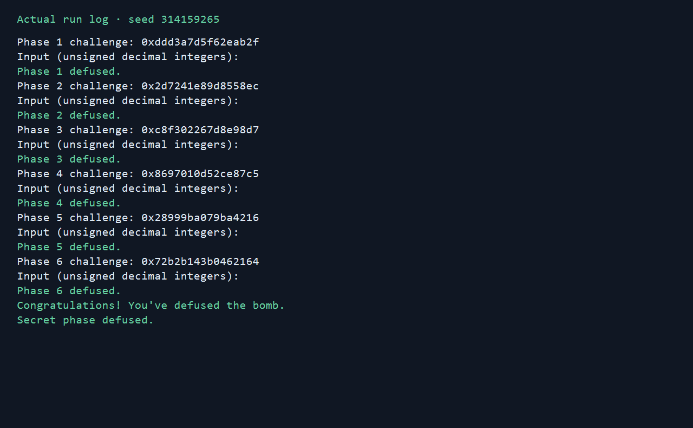

# BombLab 实验报告

## 实验方法

使用本人领取的 `bomb`，通过 `nm -C bomb` 定位 `phase_01` 至 `phase_06`、`secret_gate` 和相关辅助函数，再用 `objdump -d -M intel --no-show-raw-insn --disassemble=函数名 bomb` 阅读关键指令。`phase_01` 等入口使用 System V AMD64 调用约定，`rdi` 指向输入字符串，`rsi` 是 64 位 `challenge`。每关先由 `valid_u32_fields` 检查整数个数，再由 `sscanf` 读取整数，与计算结果比较。计算中的 `eax`、`edi` 等 32 位寄存器对应 `uint32_t` 运算；加法、乘法和异或后的溢出按模 2³²处理。

## 第 1 关：函数调用与参数

`phase_01` 在 `call p1_compute` 后以 `cmp [rbp-0x14],eax` 检查唯一输入。`p1_compute` 依次调用 `p1_step1`、`p1_step0`、`p1_step2`。其中 `p1_step1` 的 `lea eax,[rdi+rdi*4]`、`add eax,esi`、`xor eax,0xb2fa` 表明其结果为 `5*hi+mid` 再异或常数；`p1_step0` 把 `5*lo` 与 `hi+0x32a8` 异或；`p1_step2` 对前两个结果作最后组合。这里 `lo=(uint32_t)challenge`、`mid=(uint32_t)(challenge>>16)`、`hi=(uint32_t)(challenge>>32)`。因此口令是 `((((5*hi+mid)^0xb2fa)+0xf0af) ^ ((5*lo)^(hi+0x32a8)))`，其中每一步均按 32 位无符号整数计算。

## 第 2 关：数组与递推

`phase_02` 以 `valid_u32_fields(input,6)` 和 `cmp eax,0x6` 要求六个整数。`shr rax,0x15`、`and eax,0x1f`、`lea eax,[rax+rax*2]` 给出首项 `a[0]=3*((challenge>>21)&31)`。循环中的 `shr rax,cl`、`and eax,0xf`、`add eax,edx`、`lea esi,[rsi+rsi*4]` 和 `xor eax,esi` 给出 `a[i]=(((challenge>>(22+4*i))&15)+i) ^ (5*a[i-1])`，`i=1..5`。`cmp esi,eax` 逐项检查。

## 第 3 关：跳转表

`phase_03` 用 `challenge&7` 检查第一个整数，把 `((uint32_t)(challenge>>3)) ^ ((uint32_t)(challenge>>32))` 传给 `p3_dispatch`。`p3_dispatch` 的 `notrack jmp QWORD PTR [rax*8+0x405820]` 是跳转表，读取只读区表项后，索引 0..7 分别跳到 `p3_case_4`、`2`、`6`、`1`、`7`、`3`、`0`、`5`。每个 case 的 `lea`、`shr`、`xor` 等指令给出第二个整数的计算，代码中的 `switch` 按此顺序实现。`cmp [rbp-0x14],eax` 检查结果。

## 第 4 关：递归

`phase_04` 只接收一个整数。它取 `target=challenge&127` 和 `salt=(uint32_t)(challenge>>7) ^ (uint32_t)(challenge>>32)`，调用 `p4_walk(target,0,127,salt)`。`p4_walk` 通过 `sub edi,esi; shr edi,1; add edi,esi` 取区间中点。若中点等于目标，返回 `(mid+0x59)^salt`。向左递归后用 `lea eax,[rax+rax*2]` 将子结果乘 3，再异或 `mid+salt` 和 `7`；向右时最后异或 `0x15`。在 `defuser.c` 中照此恢复递归关系，输出递归返回值。

## 第 5 关：结构体和链表

`phase_05` 需要两个整数。`p5_traverse` 先用 `challenge&7` 从 `0x405b60` 的八个头指针选节点，并用 `(challenge>>3)&3` 决定沿 `next` 走几步。节点在只读区 `0x405ba0` 起，每个节点 16 字节：偏移 0 是下一节点指针，偏移 8 是节点值，偏移 12 是加数。初始混合量为 `((uint32_t)(challenge>>6) ^ (uint32_t)(challenge>>32)) ^ 0x7632`。每访问一个节点，`lea eax,[rax+rax*2]`、`add eax,[rdx+0xc]`、`xor eax,[rdx+0x8]` 表示 `acc=(3*acc+add)^value`。`phase_05` 比较第一个输入与 `acc`，第二个输入与最终节点的 `value`。

## 第 6 关：函数指针表

`p6_dispatch` 将 `(uint32_t)(challenge>>6) ^ (uint32_t)(challenge>>32)` 作为初始参数。`call QWORD PTR [rax*8+0x405e00]` 按 `challenge&7` 选择第一操作，结果异或 `0xebf5`；第二次间接调用按 `(challenge>>3)&7` 选操作，最后加 `0x5d80`。只读区表项按索引 0..7 指向 `p6_op_5`、`0`、`2`、`3`、`1`、`1`、`4`、`1`。其中 `p6_op_2` 的 `ror eax,0x3` 是 32 位循环右移，`p6_op_4` 的 `rol eax,0x3` 是循环左移；其他函数由移位、异或、`lea` 恢复。`defuser.c` 的 `p6_op` 与表按此顺序组合，输出一个整数。

## Honor：输入布局与上下文

`secret_gate` 先由 `strlen` 约束整行长度，再用 `secret_copy` 复制。`cmp DWORD PTR [rbp-0xb0],0x4e45504f` 要求从偏移 32 开始的四个字节为 `OPEN`（小端序）。它从偏移 36 起把余下文本交给 `secret_phase`。`secret_phase` 要求三个无符号整数：第一项为 `context&3`；第二项由 `secret_mix(ch^ctx)` 异或 `(first*0xbb96) ^ (context>>16)` 得出，其中 `ch=(uint32_t)(challenge>>32)^(uint32_t)challenge`，`ctx=(uint32_t)(context>>32)^(uint32_t)context`，`secret_mix(x)=(5*x+0xbb96)^0x5407`；第三项为 `second ^ (ctx+first+0x5407+(ch>>7))`。实现先放 32 个填充字符和 `OPEN`，随后写三个整数。

## 验证记录

先运行 `make`，再运行 `python3 public_test.py`，结果为六关 **60/60**、Honor **10/10**。公开 seed 来自 `tests/public.json`。另选不在该列表中的 `314159265`，将 `./defuser --seed 314159265` 的六行与 `./defuser --seed 314159265 --secret` 的一行送入 `./bomb --seed 314159265`，六关与 Honor 全部通过。实际输出保存在 [运行日志](images/validation-314159265.log)，可复核每关的 challenge 和 `defused` 结果。此外，对 seed `1000` 至 `1127` 逐个进行完整七行端到端验证，128 次均通过。下图展示这次运行的结果。

## 资料与辅助工具

- 课程 [BombLab 模板仓库](https://github.com/ICS-26Fall-FDU/BombLab) 的 `README.md`、`tutor/README.md` 和 `tests/public.json`，用于确认接口、提交与测试要求。
- 本人领取的 `bomb`；`nm` 和 `objdump`，用于查看符号与汇编；`make` 和 `public_test.py`，用于编译和运行测试。
- Codex AI 辅助恢复汇编中的关系、编写 `defuser.c`、整理本报告和定位第 6 关的旋转操作错误。报告中的推理与代码应由提交者逐项核对并确保能够解释。
